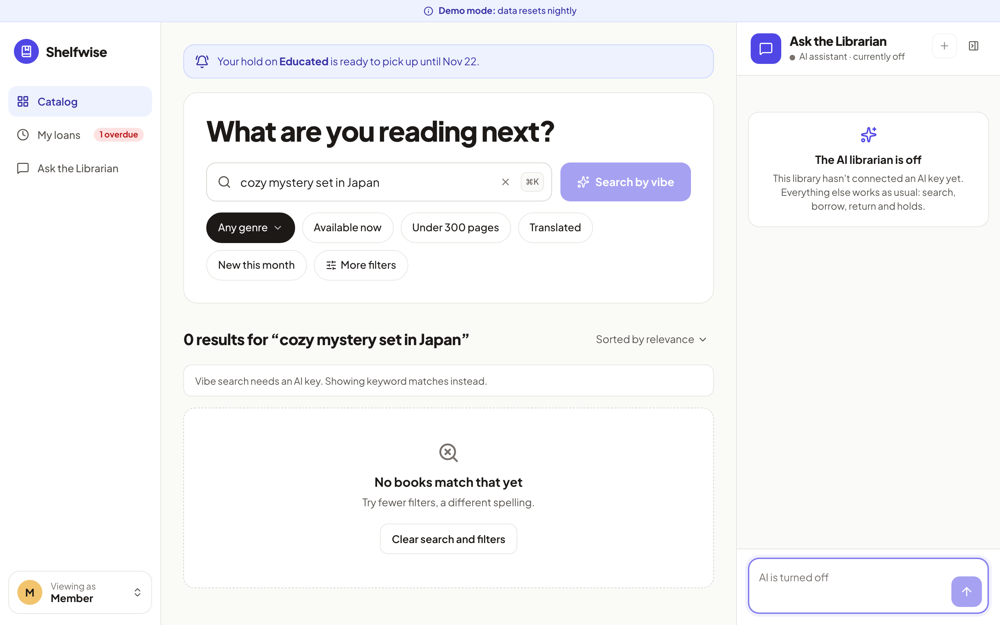
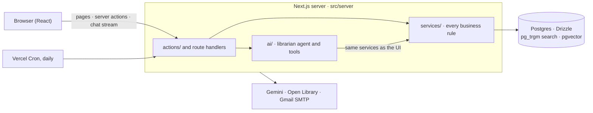
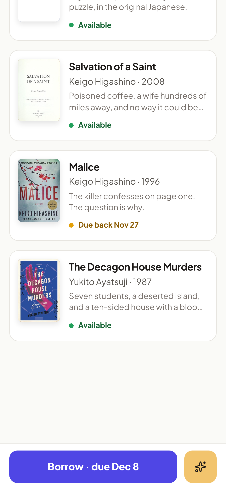

# Shelfwise

A mini library management system with an AI librarian built in. Members search, borrow, return and reserve books, and librarians run the catalog. An AI agent can find, reserve and borrow books for you, but only once you confirm.

**▶ 2½-minute narrated walkthrough.** GitHub starts videos muted, so turn the sound on.

https://github.com/user-attachments/assets/aa0da3f6-06db-4a69-8073-71448628ae33

**No sign-up needed.** The sign-in page has a one-click button for each role, so you can be a member, a librarian or an admin in one click. Google sign-in (SSO) is built in too and turns on with two environment variables. The live demo leaves it off so nobody has to sign in with a real account.
**Live demo:** shared privately, so ask me for the link. Everything below also runs locally in five commands.



## Try it

| Sign in as | Role | Worth a look |
|---|---|---|
| Maya Chen | Member | An overdue loan (*Circe*), a hold on *Educated* that's ready to pick up, Ask the Librarian |
| Leo Brandt | Librarian | Add books by ISBN, barcode or shelf photo; the loans desk; the dashboard; the email outbox |
| Ada Okafor | Admin | Users and roles, plus everything a librarian can do |
| Sam Rivera | Member | A fresh account with no history |

1. As **Maya**, ask the librarian for *"something short and funny, and borrow it for me"*, then press **Borrow** on the card it offers.
2. Turn on **Search by vibe** and try *"cozy mystery set in Japan"*.
3. Switch to **Leo** from the "Viewing as" card. In **Add books**, look up ISBN `9780804172448`, then try **From a shelf photo**.
4. Switch to **Ada**, open **Users**, and make Sam a librarian.

The switcher changes the real session, so the server enforces each role's permissions; it isn't a UI toggle. The demo resets every night, so feel free to break things.

## What the brief asked for, and where it is

| Brief | In Shelfwise |
|---|---|
| Add, edit and delete books | **Add books** (by hand, ISBN lookup, barcode scan or shelf photo); **Edit** and **Delete** on any book page as a librarian. Delete is blocked while a copy is on loan. |
| Check in and check out | **Borrow** and **Return** on every book page, **My loans** for members and the **Loans desk** for librarians. The brief uses check-in for borrowing and check-out for returning, the reverse of everyday library use, so the UI says Borrow and Return so nobody has to guess. |
| Search | One box over title, author, ISBN and tags. It forgives typos ("hobit" finds *The Hobbit*), filters by genre, availability, language, year and length, and keeps the query in the URL so a search can be shared. |
| README and source | This repository. |
| *Bonus:* deploy | Vercel + Neon Postgres, with a daily cron for reminders and the demo reset. |
| *Bonus:* SSO and roles | Google sign-in through Auth.js. Three roles (member, librarian, admin) sit behind one `can(user, action)` check, which returns real 403s for pages, server actions and APIs. |
| *Bonus:* AI | **Ask the Librarian**, an agent with eight tools. **Search by vibe**, which ranks books by meaning with embeddings. **Shelf-photo import**: Gemini reads the spines and you review each match before anything is saved. |
| *Bonus:* extras | Holds with a waiting list, one renewal, overdue flags, reminder emails with an outbox to preview them, a librarian dashboard, an activity log, Undo on borrow and return, a ⌘K command palette, and a phone layout. |

## How it's built

There is a backend. It's the server half of the Next.js app, in [`src/server`](src/server):

- Pages render on the server and read through a service layer.
- Every change goes through a server action.
- The chat streams from a route handler (`/api/ai/chat`).
- A daily cron (`/api/cron/reminders`) sends reminders and resets the demo.
- Postgres holds everything, including the search indexes and the embeddings.



I kept it as one deployable rather than a separate API server. The only client is this UI, and sharing types between server and browser rules out a whole class of mismatches. If a mobile app or a partner integration ever needed an API, I'd put a versioned REST layer over the same services. Lint rules keep that possible: the services can't import Next.js, pages can't query the database, and server code can't import UI.

```
src/
  app/            routes: catalog, books/[id], loans, ask, admin/*, api/ai/chat, api/cron
  components/     shadcn/ui plus one folder per feature
  server/
    services/     books, catalog, loans, holds, users, notifications: all business rules
    ai/           agent loop, tools (lookups, and write tools that only propose), vision, embeddings
    auth/         Auth.js config, the can() matrix, demo accounts
    db/           Drizzle schema, migrations, seed
    actions/      thin server actions over the services
    email/        templates, SMTP transport, outbox
  lib/            shared by browser and server: zod schemas, ISBN helpers, chat stream types
```

**Stack:** Next.js 16 (App Router), TypeScript (strict), Tailwind 4 with shadcn/ui, Postgres with Drizzle, Auth.js v5, Gemini through `@google/genai`, Vitest, Playwright, GitHub Actions, Vercel.

## Run it locally

You need Node 22+, pnpm and Docker.

```bash
git clone https://github.com/karimelhoshy/library-management-system shelfwise && cd shelfwise
pnpm i
docker compose up -d                 # Postgres 17 with pgvector on localhost:54329
cp .env.example .env.local           # set DATABASE_URL and AUTH_SECRET (openssl rand -base64 32)
pnpm db:migrate && pnpm db:seed      # 60 real books with covers, plus loans and holds
pnpm dev                             # http://localhost:3000
```

Set `DEMO_MODE=true` for the one-click demo accounts, and `GEMINI_API_KEY` (free at [aistudio.google.com](https://aistudio.google.com/apikey)) for the AI features. Without a key, the AI surfaces say they're off and everything else works.

`pnpm test` runs the unit tests; add `TEST_DATABASE_URL` to also run the Postgres integration tests. `pnpm test:e2e` runs the Playwright smoke tests, and `pnpm video` records the narrated walkthrough above.

## How I know it works

- **70 Vitest tests:** unit tests for the lending rules, the permission matrix and ISBN parsing, plus integration tests against a real Postgres:
  - Two people borrowing the last copy at the same moment: exactly one wins.
  - A return hands the copy to the first person in the hold queue, and undoing a borrow gives a ready hold back.
  - Members can't act for other people.
  - A loan renews once, then refuses.
  - The AI agent runs end to end with a scripted fake Gemini, and a member confirms its card while the reply is still streaming.
- **Playwright smoke tests:** a member searches "hobit", borrows *The Hobbit* and returns it; a librarian adds, edits and deletes a book; a member opening a staff page gets a 403.
- **CI** runs lint, typecheck and the full Vitest suite against Postgres on every push.
- **Not measured yet:** how often the agent picks the right tool. That needs an eval set (next steps).

## Decisions and trade-offs

- **The AI can't change data on its own.** Borrow, hold and renew come back as a card, and nothing happens until the member presses it. It costs one tap. In return the model never acts unseen, and confirming runs the same services as the regular buttons, so the agent can't do anything the UI couldn't.
- **Availability is computed, never stored.** It's copies minus open loans minus copies set aside for holds. Each borrow, return or hold locks the book's row, so two people can't take the last copy. That's simple and correct at library scale; a very busy catalog would want an inventory table with optimistic versioning.
- **The AI is a guest, not a dependency.** Without a key, the app works and the AI surfaces explain they're off. With a key:
  - Chat and shelf-photo calls fall back across models (3.8, then 3.7, then 3.6 Flash). A model that's overloaded, out of quota, unavailable or silent for 20 seconds is skipped.
  - Each user gets an hourly allowance (40 chat messages, 10 photo scans, 120 vibe searches).
  - The whole library shares a daily budget, which the librarian dashboard shows.
  - Both limits are counted in Postgres, so they hold across serverless instances.
- **Demo mode is a shared sandbox.** Anyone can be Ada, so demo staff can only see and change demo accounts, never real Google users.
- **JWT sessions, with the role read fresh on each request.** The one-click demo sign-in needs JWT sessions. I still read the role from the database on every request rather than trusting the token, so a role change applies on the next click.
- **Not built:** fines, multiple branches, per-copy barcodes (copies are a count) and CSV import. Next I'd add an eval set for the agent (about 50 scripted requests, scored on tool choice), per-copy tracking, push notifications for ready holds, and error monitoring.

Every decision is logged in one line in [`docs/DECISIONS.md`](docs/DECISIONS.md).

<details>
<summary><b>Self-hosting</b></summary>

[](https://vercel.com/new/clone?repository-url=https%3A%2F%2Fgithub.com%2Fkarimelhoshy%2Flibrary-management-system&env=DATABASE_URL,AUTH_SECRET&envDescription=Postgres%20URL%20(with%20pgvector)%20and%20a%20random%20session%20secret&envLink=https%3A%2F%2Fgithub.com%2Fkarimelhoshy%2Flibrary-management-system%2Fblob%2Fmain%2F.env.example)

Only `DATABASE_URL` and `AUTH_SECRET` are required. Run `pnpm db:migrate` against your database once, and `pnpm db:seed --books-only` if you'd like the sample catalog. Everything else is optional and switches itself off when it's missing:

| Variable | Without it |
|---|---|
| `AUTH_GOOGLE_ID`, `AUTH_GOOGLE_SECRET` | No Google button (redirect URI: `https://<domain>/api/auth/callback/google`) |
| `GEMINI_API_KEY` | No chat, vibe search or shelf-photo import |
| `GMAIL_USER`, `GMAIL_APP_PASSWORD` | Emails go to the Outbox but aren't delivered |
| `CRON_SECRET` | The daily job refuses to run |
| `DEMO_MODE` | No demo accounts, switcher, banner or nightly reset |
| `NEXT_PUBLIC_APP_NAME` | Defaults to "Shelfwise" |

To make yourself an admin on a fresh install, sign in once, then run `update users set role = 'admin' where email = 'you@…';`.

</details>

| Dashboard | Phone |
|---|---|
|  |  |

[MIT](LICENSE)
