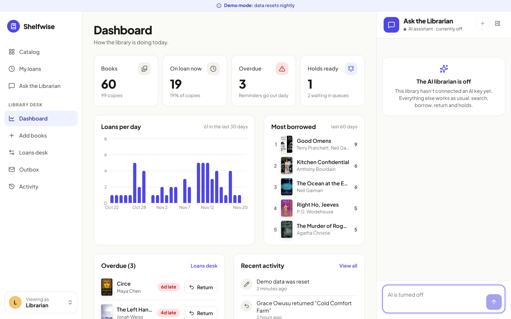

# Shelfwise

A small library system with a librarian built in: search the catalog, borrow and return books, join a hold queue, and ask an AI librarian that can find, hold and borrow books for you (always with your confirmation).

**Live demo:** _coming with the first deploy_ · Built for the Valsoft take-home, published as open source (MIT).


## Try it in 2 minutes

1. Open the live demo and click **Continue as Member (Maya)**. Note the **1 overdue** badge in the sidebar and the notice that her hold on *Educated* is ready.
2. In **Ask the Librarian**, type *"something short and funny I can borrow today"*, then press **Borrow** on the card it offers.
3. Turn on **Search by vibe** and try *"cozy mystery set in Japan"*.
4. Switch to **Librarian (Leo)** from the "Viewing as" card. Go to **Add books**, look up ISBN `9780441172719` (or scan a barcode on your phone), then try **From a shelf photo**.
5. Open the **Dashboard** and the **Outbox** (the reminder emails the daily job sent).
6. Switch to **Admin (Ada)**, open **Users**, and make Sam a librarian.

The demo resets every night, so feel free to break things.

## Demo accounts

| Account | Role | What to look at |
|---|---|---|
| Ada Okafor | Admin | Users & roles, plus everything below |
| Leo Brandt | Librarian | Add books (ISBN, scan, shelf photo), loans desk, dashboard, outbox |
| Maya Chen | Member | An overdue loan (*Circe*), a ready hold (*Educated*), a regular loan |
| Sam Rivera | Member | A fresh account with no history |

The switcher changes the **real session**, so the server enforces each role's permissions; it isn't a UI toggle. Google sign-ins join as members.

## A note on Borrow and Return

The brief says a book is "checked in (borrowed)" and "checked out (returned)", which is the reverse of how libraries use those words. The UI says **Borrow** and **Return** everywhere to avoid the confusion.

## What's in it

**Required by the brief**

- **Book management:** add, edit and delete books with title, authors, ISBN, cover, description, genres/tags, publisher, year, pages, language, copies and shelf. Validated with zod on both client and server. Delete asks for confirmation and is blocked while a copy is on loan.
- **Borrow and return:** 14-day loans. Availability is computed (copies − open loans − copies set aside for holds), never stored. Each borrow, return or hold locks the book row, so two people can't take the last copy (there's a Postgres test that fires both requests at once).
- **Search:** one box over title, author, ISBN and tags, typo-tolerant via `pg_trgm` ("hobit" finds *The Hobbit*). Filters for genre, availability, language, year, pages, "translated" and "new this month"; sort by relevance, title, newest or most borrowed. Results update as you type and the query lives in the URL, so searches can be shared.
- **README and source:** you're reading it.

**Bonuses**

- **Deployed** on Vercel + Neon with a daily cron.
- **SSO with roles:** Google sign-in via Auth.js v5, three roles behind a single `can(user, action)` check, real 403s for pages, server actions and APIs.
- **Ask the Librarian (AI agent):** Gemini function calling over eight tools (search, semantic search, book details, availability, my loans, place hold, borrow, renew), up to 5 steps, streamed. Anything that changes data comes back as a **confirm card**; nothing happens until you press it. Mentioned books appear as clickable cards.
- **Search by vibe:** each book is embedded (`gemini-embedding-001`, 768 dims) and ranked by pgvector cosine similarity.
- **Shelf-photo import:** photograph a shelf; Gemini vision reads the titles, each is matched against the catalog and Open Library, and you tick, edit and import. Books you already own become "add a copy".
- **Add by ISBN or barcode:** Open Library fills in the details; the phone camera scans EAN-13 barcodes (native `BarcodeDetector`, ZXing fallback).
- **Holds and waitlist:** returns hand the copy to the first person waiting, who gets an email and an in-app notice; unclaimed holds expire after 3 days and pass on.
- **Renewals and overdue:** renew once if nobody is waiting; overdue badges and a sidebar count.
- **Librarian dashboard:** stats, loans-per-day chart, most borrowed, overdue list with Return buttons, activity feed.
- **Email reminders:** a daily job sends due-soon and overdue reminders. Every email is also written to an **Outbox** that librarians can preview, so you can see them without a real inbox.
- **⌘K command palette**, **activity log**, optimistic Borrow/Return with **Undo**, skeletons, empty states, 403/404 pages, and a phone layout with a bottom tab bar and a full-screen chat.

## Tech stack

Next.js 16 (App Router, server components, server actions), TypeScript strict, Tailwind 4 + shadcn/ui (Radix) + lucide, Postgres (Neon) with pgvector and pg_trgm, Drizzle ORM, Auth.js v5, `@google/genai` (`gemini-3.8-flash` for chat, tools and vision; `gemini-embedding-001` for embeddings), Nodemailer over Gmail SMTP, Recharts, Vitest, Playwright, GitHub Actions, Vercel Cron.

### Architecture

```
src/
  app/                 routes: catalog, books/[id], loans, ask, admin/*, api/ai/chat, api/cron
  components/          ui (shadcn) + feature components
  server/
    db/                Drizzle schema, migrations, idempotent seed
    services/          books, catalog, loans, holds, users, notifications ← all business rules
    ai/                agent.ts (tool loop + streaming), tools.ts (tools → services + can()),
                       vision.ts (shelf photo), embed.ts, rate-limit.ts
    auth/              Auth.js config, can() matrix, demo provider, demo scoping
    email/             templates, Nodemailer transport, outbox writer
    actions/           thin server actions over the services
  lib/                 zod schemas, ISBN helpers, Open Library client
```

Server actions and AI tools call the **same services**, so a rule like "renew once, only if nobody is waiting" lives in one place (`services/rules.ts`) and the AI can't do anything the UI couldn't. Gemini, Open Library and SMTP are only called from the server.

## Run it locally

You need Node 22+, pnpm, and Postgres with the `vector` extension (Docker works).

```bash
git clone https://github.com/karimelhoshy/library-management-system shelfwise && cd shelfwise
pnpm i
docker compose up -d                 # Postgres 17 + pgvector on localhost:54329
cp .env.example .env.local           # set DATABASE_URL and AUTH_SECRET (openssl rand -base64 32)
pnpm db:migrate && pnpm db:seed
pnpm dev                             # http://localhost:3000
```

Set `DEMO_MODE=true` to get the demo accounts. Other scripts: `pnpm lint`, `pnpm typecheck`, `pnpm test` (add `TEST_DATABASE_URL` to also run the Postgres integration tests), `pnpm test:e2e`, `pnpm db:reset`, `pnpm db:embed`.

## Self-hosting

[](https://vercel.com/new/clone?repository-url=https%3A%2F%2Fgithub.com%2Fkarimelhoshy%2Flibrary-management-system&env=DATABASE_URL,AUTH_SECRET&envDescription=Postgres%20URL%20(with%20pgvector)%20and%20a%20random%20session%20secret&envLink=https%3A%2F%2Fgithub.com%2Fkarimelhoshy%2Flibrary-management-system%2Fblob%2Fmain%2F.env.example)

Only `DATABASE_URL` and `AUTH_SECRET` are required. Run `pnpm db:migrate` against your database once (and `pnpm db:seed --books-only` if you'd like the sample catalog). Everything else is optional and switches itself off when missing:

| Variable | Without it |
|---|---|
| `AUTH_GOOGLE_ID`, `AUTH_GOOGLE_SECRET` | No Google button (redirect URI: `https://<domain>/api/auth/callback/google`) |
| `GEMINI_API_KEY` | No chat, vibe search or shelf-photo import; everything else works |
| `GMAIL_USER`, `GMAIL_APP_PASSWORD` | Emails are written to the Outbox but not delivered |
| `CRON_SECRET` | The daily job refuses to run |
| `DEMO_MODE` | Off: no demo accounts, switcher, banner or nightly reset |
| `NEXT_PUBLIC_APP_NAME` | Defaults to "Shelfwise" |

To rebrand, set `NEXT_PUBLIC_APP_NAME` and change the colour tokens at the top of `src/app/globals.css`. To make yourself an admin on a fresh install, sign in once, then run `update users set role = 'admin' where email = 'you@…';`.

## AI features and how they degrade

The AI is a guest, not a dependency. With `GEMINI_API_KEY` unset, the chat column says the librarian is off, "Search by vibe" is disabled with a tooltip, and shelf-photo import points you to ISBN lookup. With a key, Gemini 429s and 5xxs become a friendly "try again in a minute", and each user is limited to 40 chat messages, 10 photo scans and 120 vibe searches per hour (counted in Postgres under an advisory lock, so it holds across serverless instances). Embeddings are refreshed only when a book's text changes (a hash is stored next to the vector).

## Trade-offs and what I'd do next

- **Write actions need a click, every time.** The agent can't borrow on its own, even when you asked it to. It costs one tap, and in return the model never changes data without the member seeing exactly what will happen. It also meant the agent could reuse the normal services instead of having its own write path.
- **Row locks instead of a stored "available" counter.** Locking the book row serialises changes per title. That's simple and correct at library scale; a very high-traffic catalog would want an inventory table with optimistic versioning instead.
- **Demo mode is a shared sandbox.** Anyone can be Ada, so demo staff are limited to demo accounts: they can't see or change real Google users, their emails or their loans.
- **JWT sessions, fresh role on each request.** The demo sign-in needs JWT sessions; I read the role from the database on every request instead of trusting the token, so a role change applies on the next click.
- **Not built:** fines, multiple branches, per-copy barcodes (copies are a count), CSV import/export, recommendations on the home page, and dark mode. Next I'd add per-copy tracking, push notifications for ready holds, an eval set for the agent (tool-choice accuracy on ~50 scripted requests), and Sentry.

Decisions are logged one line each in [`docs/DECISIONS.md`](docs/DECISIONS.md); build notes per phase are in [`docs/PROGRESS.md`](docs/PROGRESS.md).

## Screenshots

| Dashboard | Phone |
|---|---|
|  |  |

## License

[MIT](LICENSE)
